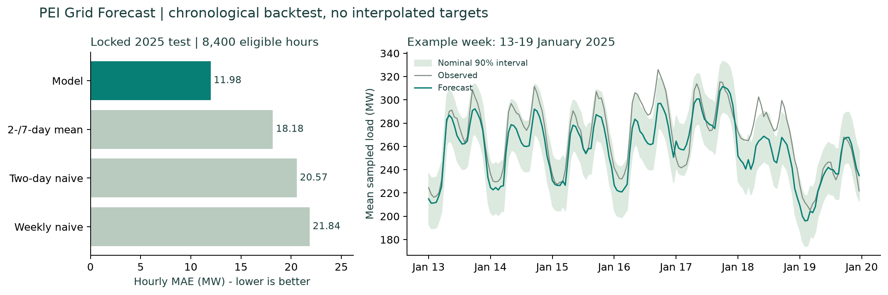

# PEI Grid Forecast

**A reproducible day-ahead electricity-demand forecasting study for Prince Edward Island.**

Built by Faris Elsabah as independent educational research. The question: at 18:00 Atlantic, how well can we predict the following local day's hourly mean sampled island load, using only explicitly timed historical inputs?



## Measured results

The model and all three baselines are scored on the **same 8,400 eligible hours in calendar 2025** (95.89% of calendar hours). Candidate selection uses January-June 2024; quarterly test refits never select new hyperparameters from test scores.

| Method | Hourly MAE, MW | RMSE, MW |
|---|---:|---:|
| Weather + load gradient boosting | **11.98** | **15.89** |
| Mean of two-/seven-day profiles | 18.18 | 24.48 |
| Two-day naive | 20.57 | 27.60 |
| Weekly naive | 21.84 | 29.88 |

**34.1% lower MAE than the strongest simple baseline.** This is a comparison against these baselines on this dataset, not against a utility's production forecast. A seeded seven-calendar-day block bootstrap gives an approximate 95% interval of **4.94-7.81 MW** for the average daily MAE improvement. The separately reported 2026 extension contains 6,765 eligible hours through November 12, with **11.81 MW MAE** and 89.20% calendar coverage.

Weaknesses remain part of the result: average 2025 bias is **-5.26 MW**, high-load recall **68.0%**, and nominal 90% intervals cover **86.9%**, below their nominal target. Historical backtests do not establish future operational performance.

## What is delivered

- Cached, fingerprinted downloads of electricity observations and archived forecast weather.
- A source-quality audit, rejected-reading file and explicit evaluation-coverage report.
- Features with forecast-origin, data-cutoff and source-timestamp lineage.
- Four development candidates, three simple baselines and eight quarterly test windows.
- Separate interval calibration, high-load precision/recall, daily-peak metrics, monthly breakdowns and worst-day diagnostics.
- A responsive, dependency-free browser application with study-day selection, results, provenance and downloadable evidence.
- An energy-conserving load-shifting simulator, with capped adjustments and explicit assumed flexibility.
- A one-page PDF decision brief, a technical model card and reproducibility records.
- Automated numerical, leakage, DST, failure-mode and Python/JavaScript consistency tests.

## Run locally

Python 3.13 is the reference environment. Node 22+ runs optional JavaScript checks. No paid API key, database server, Docker or GPU is required.

```bash
python3.13 -m venv .venv
source .venv/bin/activate
pip install -r requirements-lock.txt
python run.py --refresh
python make_brief.py
python -m pytest -q
node tests/check_ui.cjs
python -m http.server 8784 --bind 127.0.0.1 --directory dist
```

Open `http://127.0.0.1:8784`. After the first successful download, `python run.py` uses cached sources and performs no network calls. `--refresh` explicitly replaces source snapshots and rebuilds. `python run.py --audit-only` stops after the source and feature audit. Source requests have timeouts; invalid schemas, contradictory timezone evidence and insufficient model/forecast inputs fail visibly. No unattended refresh schedule is installed.

For a lighter installation: `pip install -e '.[test,report]'`. The lock file records the exact locally verified packages. CI uses the declared ranges on Python 3.13 and runs unit and artifact checks without downloading live source data.

The application is a **dated snapshot**, not an automatically updating operational service. The latest-day forecast is reconstructed from the downloaded archive; it was not independently logged at its historical issue time. Models are stored locally in `models/model.joblib`; never load untrusted joblib files.

## Data and timing

**Electricity:** [Peter Rukavina / Reinvented archive](https://energy.reinvented.net/), scraped from the [Government of PEI indicators](https://www.princeedwardisland.ca/en/feature/renewable-energy-indicators). The audited snapshot has 508,848 rows, November 2012-November 2026. Model development begins in 2021 to overlap the weather archive. The target is an arithmetic mean of accepted instantaneous readings within an hour, **not metered hourly energy**. Provincial generation gauges omit some net-metered production; no emissions or import-mix calculation is made.

**Timezone:** the current feed provides a Unix timestamp and human-readable wall time; they agree under `America/Halifax`. We assume the same historical timezone, reject ambiguous/nonexistent DST observations and construct 23-/25-hour target days correctly. This check does not prove the historical clock configuration.

**Load availability:** intervals must end by 17:00 for an 18:00 issue. A one-hour publication buffer is assumed; actual historical release vintages are unavailable. Features include safe elapsed-hour lags of 48/168 hours and pre-cutoff rolling summaries. A naive target-minus-24-hour lag would expose information after the issue time for later target hours, so it is deliberately excluded.

**Weather:** [Open-Meteo Previous Runs API](https://open-meteo.com/en/docs/previous-runs-api), `gfs_seamless`, `temperature_2m_previous_day2`, Charlottetown (46.2382, -63.1311), UTC validity timestamps. These are archived forecasts at a fixed 48-hour lead, not future observed/reanalysis temperatures. They are deliberately older than each issue time. The product is a lead-time archive, not a full reconstruction of the exact latest weather run available at 18:00. A single Charlottetown point is a representative proxy, not an island-wide temperature average.

## Quality gates

Reject invalid/nonpositive load and duplicate timestamps. Quarantine unchanged runs spanning at least four hours as potentially stale, while acknowledging that this rule can exclude genuine flat periods. Require three samples spanning at least 30 minutes per accepted hour. Do not interpolate target demand. Block origins with insufficient recent history or stale input, and omit hours missing target, required lag or forecast weather. Every baseline uses the same remaining hours. See `reports/eligibility.json` for denominator and exclusions; results do not describe excluded periods.

## Evaluation protocol

`protocol.json` was committed before the first model fit in local commit `b2fa915`. It is a local protocol record, not third-party preregistration. Training/validation source data had already been inspected; the test protocol was recorded before inspecting model test scores.

1. Train development candidates on available 2021-2023 examples; purge labels unavailable at the first validation origin.
2. Select lowest MAE on January-June 2024 among ridge + weather, two gradient-boosting sizes + weather, and a load-only boosting candidate. The load-only candidate is a development comparison, not a matched-hyperparameter causal estimate of weather value.
3. Keep model choice fixed. For each test quarter, train on up to three earlier years ending before a separate trailing 180-day calibration window. Purge calibration labels unavailable at that quarter's first issue.
4. Calibrate a symmetric nominal-90% interval from absolute held-out residuals. Time-series dependence means finite-sample exchangeability guarantees do not apply; report actual coverage.
5. Predict every eligible hour in 2025, then the separate 2026 extension, using a fixed model within each quarter. Compute all baseline scores on identical hours.

Peak alerts use the training-load 95th percentile for each fold, **not a grid capacity or emergency threshold**. Daily peak errors use complete local days only. The baseline shown as "strongest" is the lowest-MAE baseline observed on the primary test; model choice did not use that comparison.

## Simulator boundaries

Move assumed MWh from the highest third of predicted hours to the lowest third, respecting a user-specified per-hour MW cap. Source and destination sets are disjoint; every step preserves total energy. One row is one elapsed hour, including DST days. It models neither real device availability, customer comfort, losses, tariffs nor network constraints. Simulated peak changes are not realized savings. Partial backtest days are labelled and simulate only displayed hours.

## Verification and evidence

`python -m pytest -q` verifies numeric metrics, target aggregation, malformed data, duplicate timestamps, frozen-source rejection, DST days, future-input mutation invariance, every recorded feature's time lineage, fit/calibration boundaries, recomputed artifact metrics and simulator conservation/caps. Node parity tests compare the Python and browser simulators across 23-, 24- and 25-hour examples.

`node tests/check_ui.cjs` runs dashboard initialization and interactions using local DOM stubs: tabs, study-day selection, sliders, finite SVG coordinates and local download targets. This is **not a browser rendering test**. Browser preview access was denied by the origin approval gate during the build; visual browser layout, mobile layout and browser accessibility were not independently verified. The PDF brief was rendered and visually inspected.

Two cached rebuilds produced identical source, feature and prediction fingerprints; see `reports/repeatability.json`. Its timings cover the core download-cache/audit/feature/fit/evaluation pipeline, before presentation packaging. Mutable run timestamps are excluded from equality requirements.

## Audit files

- `reports/data_audit.json`, `rejected_readings.csv`: source quality and rejected observations.
- `reports/model_selection.json`, `folds.csv`: development comparison and temporal fit boundaries.
- `reports/backtest_predictions.csv`: every scored forecast, actual, interval and baseline.
- `reports/results.json`: primary/extension results, monthly scores, high-load metrics and worst days.
- `reports/latest_forecast.csv`, `latest_metadata.json`: most recent reconstructable daily issue.
- `reports/run_manifest.json`, `repeatability.json`: source URLs, fingerprints and repeat-run check.
- `reports/decision_brief.pdf`: one-page practitioner-facing brief.

## Local relevance and next validation

[BluWave-ai](https://www.bluwave-ai.com/about) publishes work on load prediction and grid optimization and lists a Summerside office. [Summerside Electric's 2026 Beat the Peak campaign](https://www.summerside.ca/my_services/summerside_electric/energy_conservation) illustrates local interest in peak demand. This project is not affiliated with either organization. Province-wide data cannot establish Summerside-only performance.

The next meaningful step is practitioner review and prospectively logged predictions. No employer feedback, stakeholder adoption, monetary savings or operational effect is claimed. The source landing page does not state an explicit archive reuse licence; raw downloads stay out of Git. Weather attribution: Open-Meteo and upstream GFS, CC BY 4.0. [API access terms](https://open-meteo.com/en/terms) apply separately, especially before commercial use. MIT applies to project code only.
